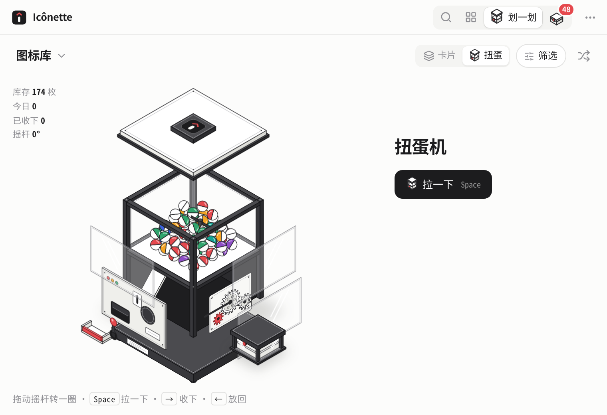
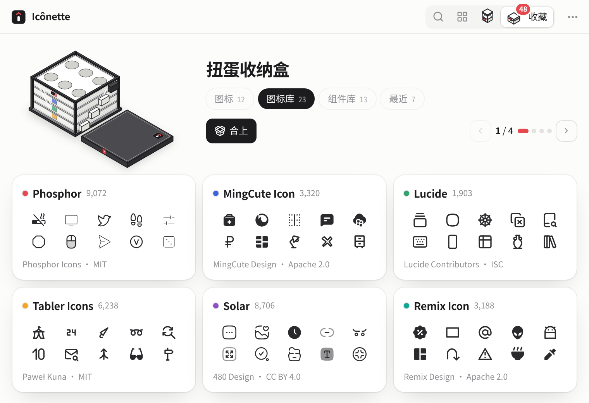
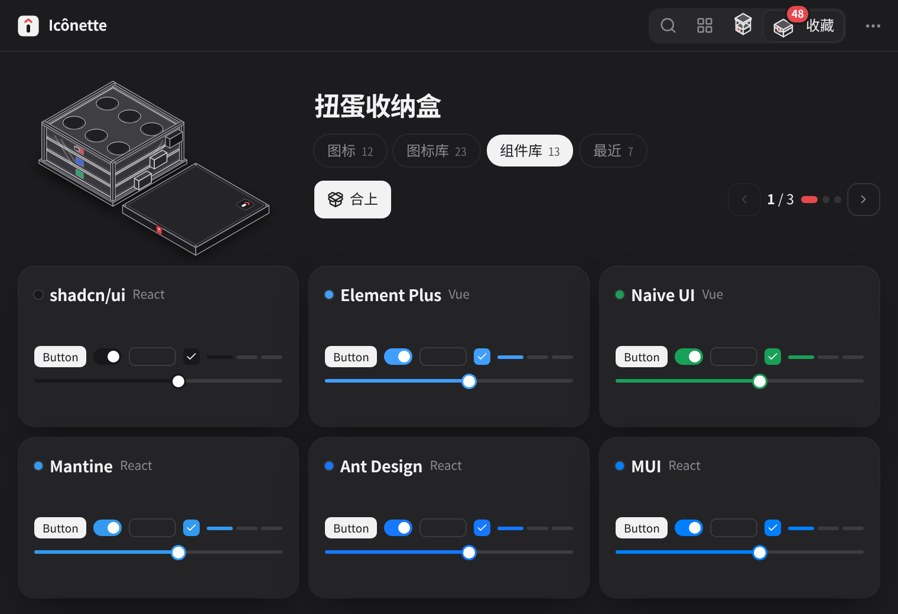

<p align="center">
  
</p>

<h1 align="center">Icônette</h1>

<p align="center">
  小小的 Icônes · 图标和 UI 组件，一搜就有<br>
  <sub>Windows · macOS（Intel + Apple Silicon）· Tauri 2 + Vue 3</sub>
</p>

> [!NOTE]
> Icônette 参考并基于 **[antfu/icones](https://github.com/antfu/icones)**（Anthony Fu 的 Icônes 图标浏览器，[icones.js.org](https://icones.js.org)）开发，图标数据来自 **[Iconify](https://iconify.design)**。感谢原作者的开源工作。

---

Icônette 是 [Icônes](https://github.com/antfu/icones) 的轻量桌面版：一个 760×520 的小窗口，按 <kbd>Alt</kbd> / <kbd>⌥</kbd> + <kbd>Space</kbd> 随时叫出来，搜 Iconify 上 200 多个图标集里的几十万个开源图标，回车就复制成 SVG、Vue、React、UnoCSS、PNG 等格式。名字里的 *-ette* 是法语「小一号」的意思。

<p align="center">
  <picture>
    <source media="(prefers-color-scheme: dark)" srcset="docs/screenshots/app-dark.png">
    
  </picture>
</p>
<p align="center"><sub>v0.3 首页：浮岛搜索框、左下角今日图标 / 最近复制、右下角迷你扭蛋机；深浅色跟随系统</sub></p>

## 功能

- **标题栏**：Logo + 大块空白拖拽区 + 分段切换（找图标 / 资源 / 迷你扭蛋机「划一划」）+ 扭蛋收纳盒「收藏」入口（带角标）；Mac 原生红绿灯（Logo 在其右侧），Windows 自绘窗口按钮
- **找图标**：首页是缓慢漂移的图标墙和浮岛胶囊搜索框（总数实时统计），左下角坞放今日图标和最近复制（可收起），右下角迷你扭蛋机一点直达扭蛋；输入后搜索吸顶、结果按图标集分组，底部有键位提示；中英文关键词（内置中文词典，搜「房子」「箭头」都行），图标名旁显示中文意思
- **范围**：搜索框里的「范围」胶囊，勾选 / 拖动排序已固定的图标集，搜索全部图标集一键固定，<kbd>Tab</kbd> 快速切换；结果头部有 线性 / 填充 / 双色、颜色、尺寸
- **复制**：SVG、PNG 图片、Vue、React、UnoCSS、Iconify 名称、Data URL 等 8 种格式；可设为单击即复制；全局图标颜色
- **资源**：「图标库」按分类列出全部 Iconify 图标集，页内搜索高亮匹配；「组件库」收录 18 个常用 React / Vue 组件库，shadcn/ui、Mantine、Element Plus、Naive UI 可在「示例面板」「全部组件」里直接操作真实组件；搜「弹窗」「tabs」等可横向对比；一键复制安装命令
- **划一划**：像刷卡片一样逛图标库、组件和组件库（或复盘「我的收纳盒」），拖动带旋转、印章和回弹，连击有粒子；点阵进度、筛选胶囊；<kbd>R</kbd> 换一批、<kbd>Z</kbd> 撤回
- **图标扭蛋机**：等距爆炸图风格的整机，彩色胶囊装在玻璃仓里；每次启动第一次进入会拆开再装回。转一圈摇杆（或按空格）掉出一枚胶囊，开壳亮出一个图标集或组件，收下就滚进旁边的收纳盒
- **扭蛋收纳盒**：任何地方收藏，图标都会变成一枚胶囊飞进标题栏的收纳盒；收藏页的大盒子每层 6 枚胶囊 = 一页 6 张卡片（图标库、组件库与组件），打开、翻层、合上都有动画；图标（可建分组）和最近复制是图标网格；「其他风格」一键看同名图标在别的图标集里的样子
- **速取窗口**：在任何应用里按 <kbd>Alt</kbd> / <kbd>⌥</kbd> + <kbd>Space</kbd> 弹出小窗，搜索、回车复制并自动收起
- **拖出 SVG**：把图标直接拖到文件夹、Figma、设计稿或聊天窗口，得到一个 `.svg` 文件
- **桌面体验**：系统托盘（显示 / 速取 / 退出）、关闭时留在托盘、开机启动、单实例、深浅色跟随系统、尊重「减少动态效果」
- **键盘优先**：<kbd>⌘</kbd>/<kbd>Ctrl</kbd> + <kbd>K</kbd> 聚焦搜索，方向键选图标，回车复制，<kbd>F</kbd> 收藏，<kbd>⌘</kbd>/<kbd>Ctrl</kbd> + <kbd>1</kbd>–<kbd>4</kbd> 切换模式

> 组件库的实时预览从 jsDelivr / esm.sh / Tailwind CDN 加载真实组件库，需要联网。

<table>
  <tr>
    <td align="center"><br><sub>找图标：吸顶搜索，底部键位提示</sub></td>
    <td align="center"><br><sub>资源：图标库 / 组件库 + 页内搜索</sub></td>
  </tr>
  <tr>
    <td align="center"><br><sub>图标扭蛋机：转一圈摇杆，开一枚图标集</sub></td>
    <td align="center"><br><sub>每次启动第一次进入：整机拆开再装回</sub></td>
  </tr>
  <tr>
    <td align="center"><br><sub>扭蛋收纳盒：一层 6 枚胶囊 = 一页 6 张卡片</sub></td>
    <td align="center"><br><sub>组件库（深色）</sub></td>
  </tr>
  <tr>
    <td align="center"><br><sub>划一划：拖动卡片，「收下」印章，点阵进度</sub></td>
    <td align="center"><br><sub>示例面板：真实 Element Plus 组件拼成的后台页</sub></td>
  </tr>
  <tr>
    <td align="center"><br><sub>速取窗口：Alt / ⌥ + Space，回车复制并收起</sub></td>
    <td></td>
  </tr>
</table>

## 下载与安装

到 **[Releases](https://github.com/Hry1729/icones-desktop/releases/latest)** 下载最新版本（每次推送到 `main` 的测试包也可以在 Actions → Build desktop → Artifacts 里找到）：

| 平台 | 文件 | 说明 |
| --- | --- | --- |
| Windows 10 / 11 | `Iconette_x.y.z_x64-setup.exe` | 推荐，装到当前用户，不需要管理员权限 |
|  | `Iconette_x.y.z_x64_en-US.msi` | 企业部署用 |
| macOS 10.15+ | `Iconette_x.y.z_universal.dmg` | Intel 和 Apple Silicon 通用 |

<table>
  <tr>
    <td align="center"><br><sub>macOS：把图标拖进「应用程序」</sub></td>
    <td align="center"><br><sub>Windows：安装向导（中文系统显示中文）</sub></td>
  </tr>
</table>

**macOS 第一次打开**：目前没有 Apple 开发者证书，系统会拦一下。把 Icônette 拖进「应用程序」后，右键 App → 打开；或者在终端执行：

```bash
xattr -cr /Applications/Iconette.app
```

## 开发

```bash
pnpm install
pnpm tauri dev     # 桌面窗口调试
pnpm dev           # 只在浏览器里调前端（http://localhost:1420）
pnpm tauri build   # 本机打包
```

需要 Node 22+、pnpm、Rust stable。Windows 需要 WebView2（Win10/11 自带），macOS 需要 Xcode Command Line Tools。

### 品牌素材

Logo、各平台图标、DMG 背景、Windows 安装向导图片都由 `brand/brand.html` 生成，改完设计后执行：

```bash
pip install playwright pillow   # 需要本机有 Chromium，路径可用 CHROMIUM 环境变量指定
python3 brand/render.py
```

会更新 `src-tauri/icons/`（Windows 等）、`src-tauri/icons/macos/icon.icns`（按 Apple 图标网格留边）、`src-tauri/dmg/background.png`、`src-tauri/nsis/*.bmp` 和 `brand/logo.svg`。

## 目录

```
src/                 Vue 3 前端
  lib/               Iconify 数据、中文词典、复制格式、存储、牌堆、等距插画与动效（iso.ts / fx.ts）、Tauri 原生封装
  components/        标题栏（Logo、扭蛋机与收纳盒小图标）、图标墙、范围弹层、图标格子、详情条、弹出菜单、提示
  views/             找图标 / 资源 / 划一划（卡片 + 扭蛋机）/ 扭蛋收纳盒
  demos/             组件库示例面板（在沙箱 iframe 里运行）
  QuickApp.vue       速取窗口（quick.html）
src-tauri/           Tauri 2（Rust）壳：剪贴板、全局快捷键、速取窗口、托盘、开机启动、拖出文件、单实例
  tauri.macos.conf.json    macOS：透明标题栏 + 原生红绿灯、DMG 窗口布局
  tauri.windows.conf.json  Windows：无边框 + 自绘按钮、NSIS 安装向导
  icons/  dmg/  nsis/      图标与安装包素材（由 brand/render.py 生成）
brand/               Logo 与安装包素材源文件
scripts/             CI 启动冒烟测试（Windows / macOS）
preview/             HTML 设计原型
```

## 进度

- [x] 窗口外壳、找图标、8 种复制格式、颜色 / 尺寸、单击复制、键盘操作
- [x] 全局快捷键唤起
- [x] 品牌：名称、Logo、DMG 安装窗口、Windows 安装向导
- [x] 资源：图标库 / 组件库 / 示例面板
- [x] 划一划
- [x] 收藏分组、最近复制、其他风格、全局图标颜色
- [x] 独立速取窗口、拖出 SVG、托盘、开机启动
- [x] v0.2 新界面：标题栏、页内搜索、范围弹层、图标墙首页、划一划新头部与卡片物理、图标扭蛋机、灵感宝箱
- [x] v0.3：等距爆炸图扭蛋机、扭蛋收纳盒（每层 6 枚）、首页左下角坞与迷你扭蛋机、浮岛搜索框、结果页键位提示

## 致谢

- [Icônes](https://github.com/antfu/icones) by Anthony Fu，原网页版代码保留在标签 `icones-original`
- 图标数据来自 [Iconify](https://iconify.design)，各图标集遵循各自的开源协议

MIT License
