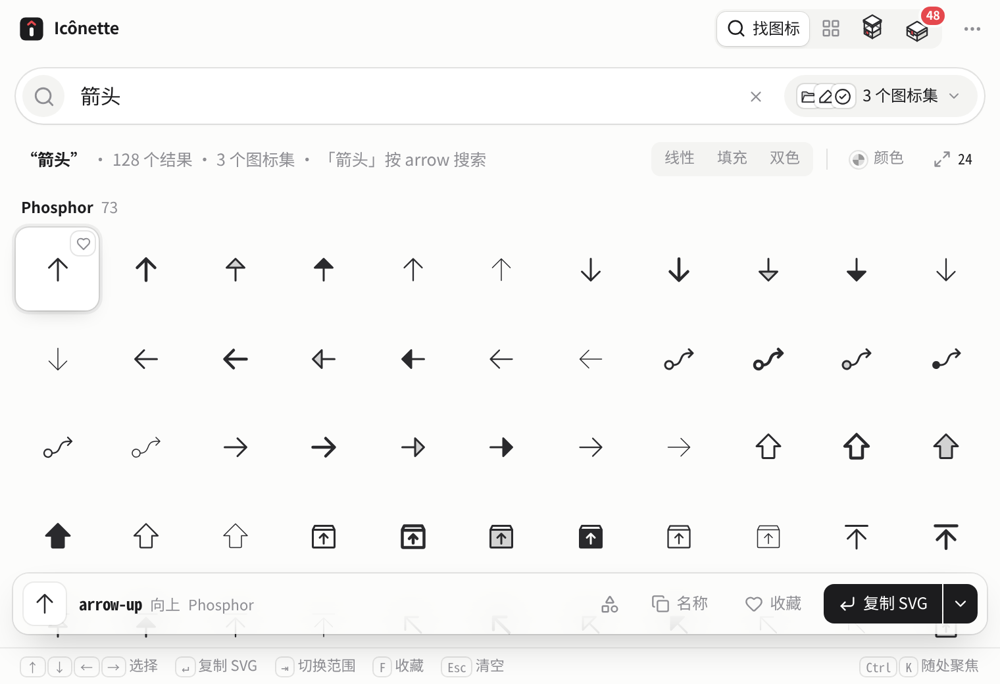
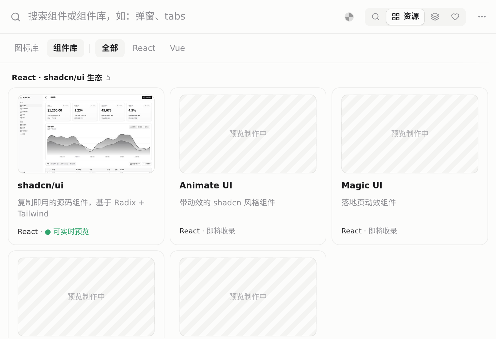
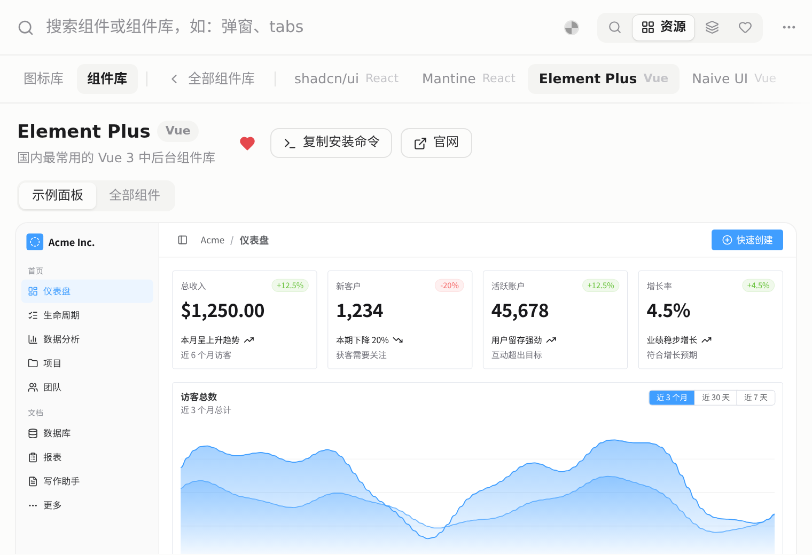
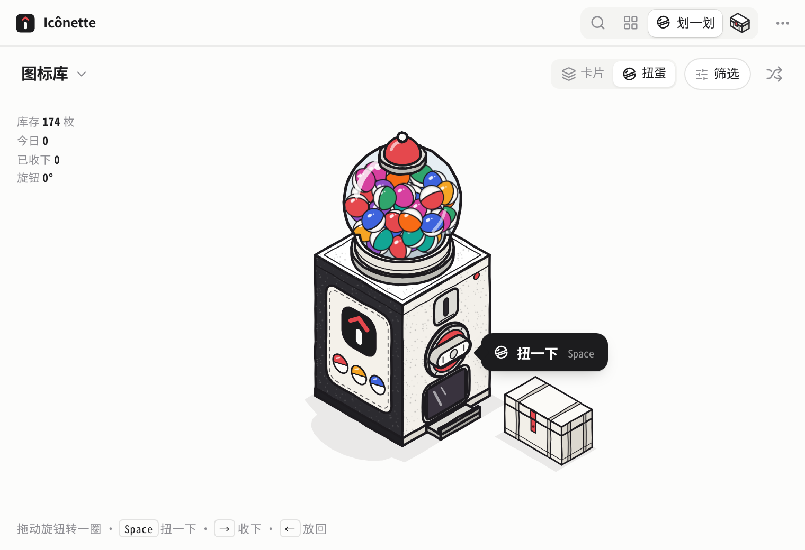
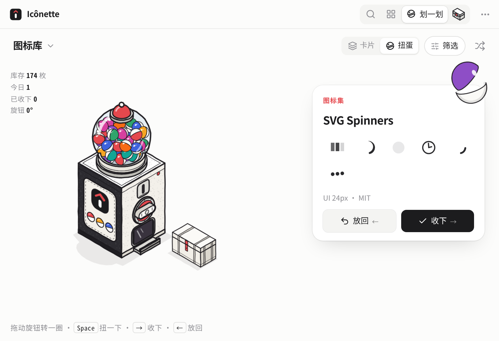
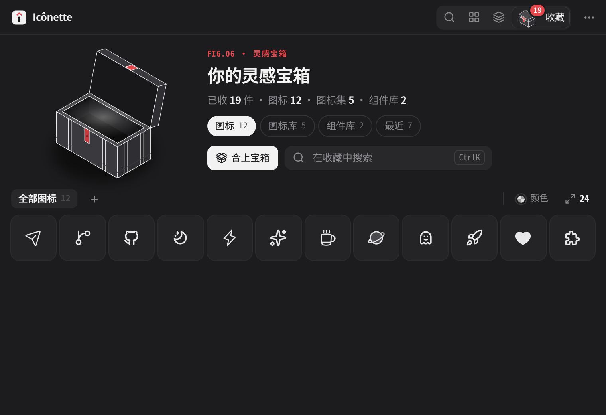
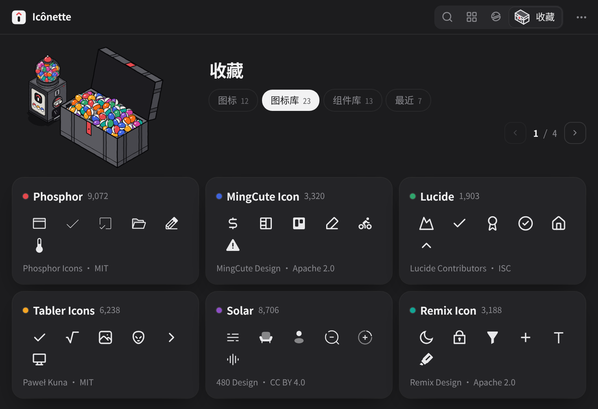
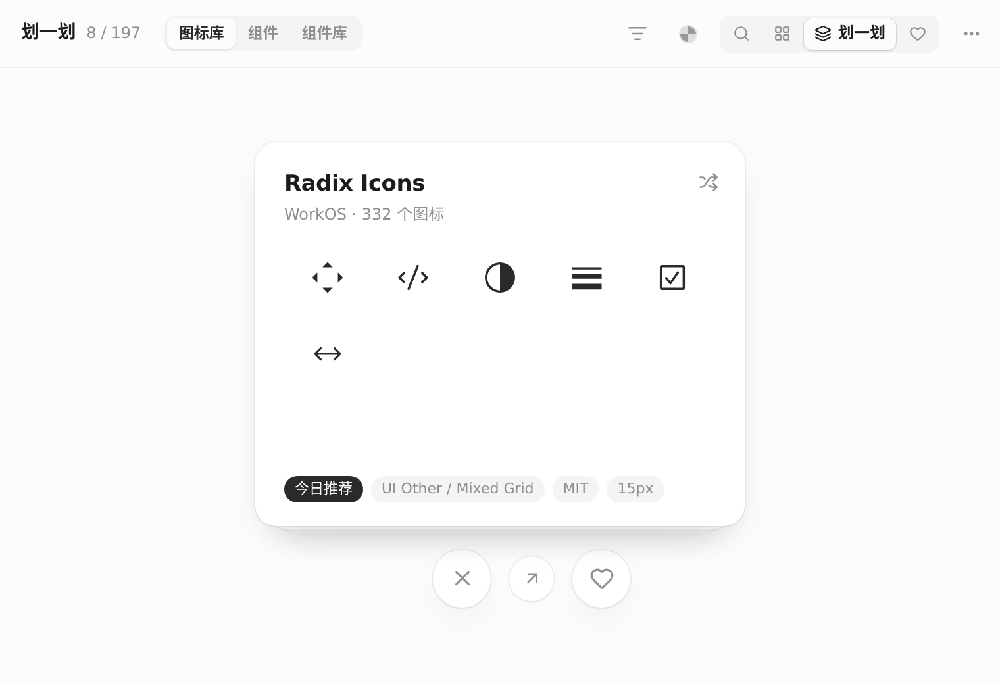
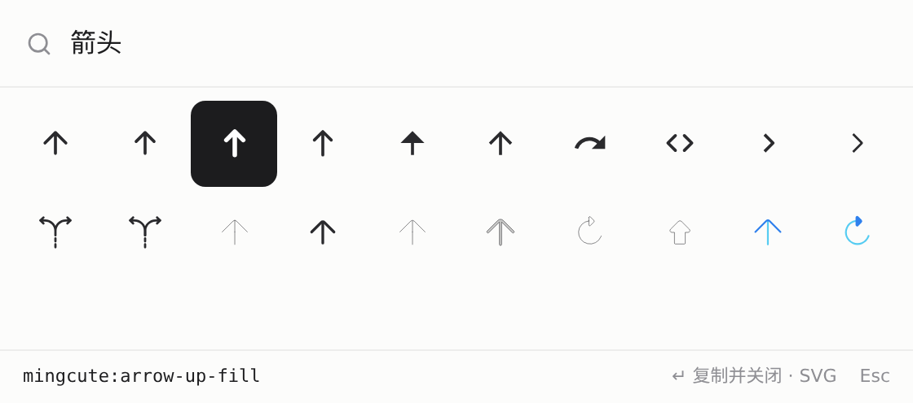

<p align="center">
  
</p>

<h1 align="center">Icônette</h1>

<p align="center">
  <b>小小的 Icônes</b> · 图标和 UI 组件，一搜就有<br>
  <sub>Windows · macOS（Intel + Apple Silicon）· Tauri 2 + Vue 3</sub>
</p>

<p align="center">
  <a href="https://github.com/Hry1729/icones-desktop/releases/latest"></a>
  <a href="LICENSE"></a>
  <a href="https://github.com/Hry1729/icones-desktop/releases/latest"></a>
  <a href="https://github.com/antfu/icones"></a>
</p>

<p align="center">
  <a href="#下载与安装"><b>下载安装</b></a> ·
  <a href="#功能一览"><b>功能</b></a> ·
  <a href="#开发"><b>开发</b></a> ·
  <a href="#致谢"><b>致谢</b></a>
</p>

> [!NOTE]
> Icônette 参考并基于 **[antfu/icones](https://github.com/antfu/icones)**（Anthony Fu 的 Icônes 图标浏览器，[icones.js.org](https://icones.js.org)）开发，图标数据来自 **[Iconify](https://iconify.design)**。感谢原作者的开源工作。

---

一个 **760×520** 的小窗口，按 <kbd>Alt</kbd> / <kbd>⌥</kbd> + <kbd>Space</kbd> 随时叫出来。

在 Iconify 的 **200+** 图标集、几十万开源图标里搜；回车，复制成 SVG / Vue / React / UnoCSS / PNG……  
名字里的 *-ette*，是法语「小一号」的意思。

<p align="center">
  <picture>
    <source media="(prefers-color-scheme: dark)" srcset="docs/screenshots/app-dark.png">
    
  </picture>
</p>
<p align="center"><sub>v0.4.5 首页：浮岛搜索、今日图标 / 最近复制、手绘迷你扭蛋机 · 深浅色跟随系统</sub></p>

## 功能一览

### 找图标

浮岛搜索、图标墙首页；中英文都能搜（内置中文词典，「房子」「箭头」都行）。  
范围胶囊固定图标集，线性 / 填充 / 双色、颜色、尺寸随手筛。  
**8 种复制格式**：SVG、PNG、Vue、React、UnoCSS、Iconify 名称、Data URL……可设单击即复制。

<p align="center">
  
</p>
<p align="center"><sub>吸顶搜索 · 结果按图标集分组 · 底部键位提示</sub></p>

### 资源：图标库 + 组件库

全部 Iconify 图标集按分类列出；**18 个**常用 React / Vue 组件库。  
shadcn/ui、Mantine、Element Plus、Naive UI 可在示例面板里直接操作真实组件，搜「弹窗」「tabs」横向对比，一键复制安装命令。

> 组件实时预览从 jsDelivr / esm.sh / Tailwind CDN 加载，需要联网。

<table>
  <tr>
    <td align="center" width="50%"><br><sub>图标库 / 组件库 + 页内搜索</sub></td>
    <td align="center" width="50%"><br><sub>示例面板：真实 Element Plus 组件</sub></td>
  </tr>
</table>

### 图标扭蛋机

手绘墨线等距风：旋钮转一圈（或空格 /「扭一下」），机身晃动移到左边，胶囊开壳亮出一个图标集或组件。  
收下飞进小宝箱，放回飞回玻璃球。

<table>
  <tr>
    <td align="center" width="50%"><br><sub>机器居中 ·「扭一下」贴在旋钮旁</sub></td>
    <td align="center" width="50%"><br><sub>开壳胶囊停在卡片右上角</sub></td>
  </tr>
</table>

### 灵感宝箱

任意位置收藏，图标变成胶囊飞进标题栏宝箱。  
开箱：胶囊沿弧线飞出变成卡片；翻页时飞回与飞出同时进行。收藏可导出 / 导入 JSON（合并或替换）。

<table>
  <tr>
    <td align="center" width="50%"><br><sub>胶囊堆 · 一页 6 张卡片</sub></td>
    <td align="center" width="50%"><br><sub>深色模式</sub></td>
  </tr>
</table>

### 划一划

像刷卡片一样逛图标库、组件，或复盘「我的宝箱」。  
拖动带旋转与回弹，收下有印章；<kbd>R</kbd> 换一批，<kbd>Z</kbd> 撤回。

<p align="center">
  
</p>
<p align="center"><sub>拖动卡片 ·「收下」印章 · 点阵进度</sub></p>

### 速取与桌面体验

<p align="center">
  
</p>
<p align="center"><sub><kbd>Alt</kbd> / <kbd>⌥</kbd> + <kbd>Space</kbd> · 回车复制并收起</sub></p>

- **速取窗口**：任意应用里唤起，搜完即走；快捷键可在菜单里重录
- **拖出 SVG**：拖到文件夹、Figma、设计稿或聊天，得到 `.svg` 文件
- **托盘日常**：关闭留托盘、开机启动、单实例、应用内更新
- **键盘优先**：<kbd>⌘</kbd>/<kbd>Ctrl</kbd>+<kbd>K</kbd> 聚焦搜索，方向键选择，回车复制，<kbd>F</kbd> 收藏，<kbd>⌘</kbd>/<kbd>Ctrl</kbd>+<kbd>1</kbd>–<kbd>4</kbd> 切模式
- 深浅色跟随系统，尊重「减少动态效果」

## 下载与安装

到 **[Releases](https://github.com/Hry1729/icones-desktop/releases/latest)** 下载最新版（推到 `main` 的测试包也可在 Actions → Build desktop → Artifacts 找到）：

| 平台 | 文件 | 说明 |
| --- | --- | --- |
| Windows 10 / 11 | `Iconette_x.y.z_x64-setup.exe` | 推荐 · 装到当前用户，无需管理员 |
|  | `Iconette_x.y.z_x64_en-US.msi` | 企业部署 |
| macOS 10.15+ | `Iconette_x.y.z_universal.dmg` | Intel + Apple Silicon 通用 |

<table>
  <tr>
    <td align="center"><br><sub>macOS：拖进「应用程序」</sub></td>
    <td align="center"><br><sub>Windows：安装向导（中文系统显示中文）</sub></td>
  </tr>
</table>

**macOS 第一次打开**：目前没有 Apple 开发者证书，系统会拦一下。拖进「应用程序」后，右键 App → 打开；或在终端执行：

```bash
xattr -cr /Applications/Iconette.app
```

## 开发

```bash
pnpm install
pnpm tauri dev     # 桌面窗口调试
pnpm dev           # 只调前端（http://localhost:1420）
pnpm tauri build   # 本机打包
```

需要 **Node 22+**、pnpm、Rust stable。Windows 需 WebView2（Win10/11 自带），macOS 需 Xcode Command Line Tools。

<details>
<summary><b>品牌素材</b>（Logo / 安装包图）</summary>

Logo、各平台图标、DMG 背景、Windows 安装向导图由 `brand/brand.html` 生成，改完设计后：

```bash
pip install playwright pillow   # 本机需 Chromium，可用 CHROMIUM 环境变量指定路径
python3 brand/render.py
```

会更新 `src-tauri/icons/`、`src-tauri/icons/macos/icon.icns`、`src-tauri/dmg/background.png`、`src-tauri/nsis/*.bmp` 和 `brand/logo.svg`。

</details>

<details>
<summary><b>目录结构</b></summary>

```
src/                 Vue 3 前端
  lib/               Iconify 数据、中文词典、复制格式、存储、动效、Tauri 封装
  components/        标题栏、图标墙、范围弹层、图标格子、详情条……
  views/             找图标 / 资源 / 划一划（含扭蛋机）/ 收藏（灵感宝箱）
  demos/             组件库示例面板（沙箱 iframe）
  QuickApp.vue       速取窗口
src-tauri/           Tauri 2（Rust）：剪贴板、全局快捷键、速取、托盘、开机启动、拖出、单实例
brand/               Logo 与安装包素材源
scripts/             CI 启动冒烟测试
preview/             HTML 设计原型
```

</details>

## 致谢

- [Icônes](https://github.com/antfu/icones) by Anthony Fu · 原网页版代码保留在标签 `icones-original`
- 图标数据来自 [Iconify](https://iconify.design)，各图标集遵循各自的开源协议

MIT License
