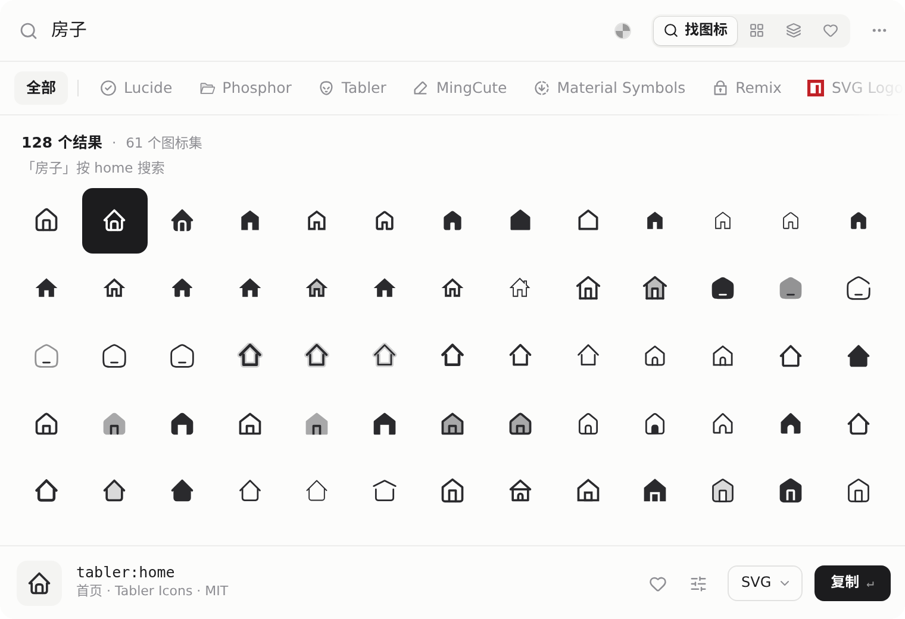
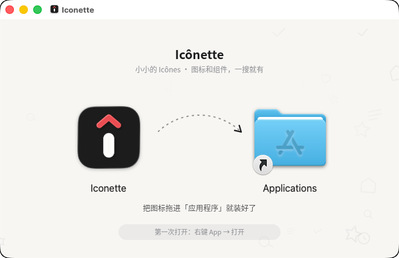
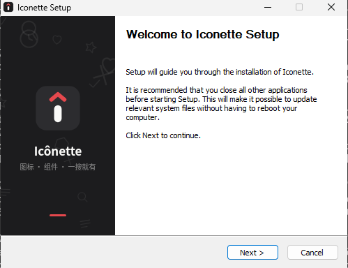

<p align="center">
  
</p>

<h1 align="center">Icônette</h1>

<p align="center">
  小小的 Icônes · 图标和 UI 组件，一搜就有<br>
  <sub>Windows · macOS（Intel + Apple Silicon）· Tauri 2 + Vue 3</sub>
</p>

> [!NOTE]
> Icônette 参考并基于 **[antfu/icones](https://github.com/antfu/icones)**（Anthony Fu 的 Icônes 图标浏览器，[icones.js.org](https://icones.js.org)）开发，图标数据来自 **[Iconify](https://iconify.design)**。感谢原作者的开源工作。

---

Icônette 是 [Icônes](https://github.com/antfu/icones) 的轻量桌面版：一个 760×520 的小窗口，按 <kbd>Alt</kbd> / <kbd>⌥</kbd> + <kbd>Space</kbd> 随时叫出来，搜 27 万个开源图标，回车就复制成 SVG、Vue、React、UnoCSS、PNG 等格式。名字里的 *-ette* 是法语「小一号」的意思。

<p align="center">
  <picture>
    <source media="(prefers-color-scheme: dark)" srcset="docs/screenshots/app-dark.png">
    
  </picture>
</p>
<p align="center"><sub>输入中文「房子」，按 home 搜出 128 个图标；深浅色跟随系统</sub></p>

## 功能

- **找图标**：中英文关键词（内置中文词典，搜「房子」「箭头」都行）、按图标集筛选、颜色 / 尺寸实时调整
- **复制**：SVG、PNG 图片、Vue、React、UnoCSS、Iconify 名称、Data URL 等 8 种格式；可设为单击即复制
- **收藏**：收藏图标，常用的随手拿
- **桌面体验**：全局快捷键唤起、单实例、深浅色跟随系统；Mac 原生红绿灯，Windows 自绘标题栏按钮
- **键盘优先**：方向键选图标，回车复制，<kbd>⌘</kbd>/<kbd>Ctrl</kbd> + <kbd>1</kbd>–<kbd>4</kbd> 切换模式

## 下载与安装

每次推送到 `main`，GitHub Actions 会自动打包。到 **Actions → Build desktop → 最新一次运行 → Artifacts** 下载：

| 平台 | 文件 | 说明 |
| --- | --- | --- |
| Windows 10 / 11 | `Iconette-windows` → `Iconette_x.y.z_x64-setup.exe` | 推荐，装到当前用户，不需要管理员权限 |
|  | `Iconette_x.y.z_x64_en-US.msi` | 企业部署用 |
| macOS 10.15+ | `Iconette-macos-universal` → `Iconette_x.y.z_universal.dmg` | Intel 和 Apple Silicon 通用 |

<table>
  <tr>
    <td align="center"><br><sub>macOS：把图标拖进「应用程序」</sub></td>
    <td align="center"><br><sub>Windows：安装向导（中文系统显示中文）</sub></td>
  </tr>
</table>

**macOS 第一次打开**：目前没有 Apple 开发者证书，系统会拦一下。把 Icônette 拖进「应用程序」后，右键 App → 打开；或者在终端执行：

```bash
xattr -cr /Applications/Iconette.app
```

## 开发

```bash
pnpm install
pnpm tauri dev     # 桌面窗口调试
pnpm dev           # 只在浏览器里调前端（http://localhost:1420）
pnpm tauri build   # 本机打包
```

需要 Node 22+、pnpm、Rust stable。Windows 需要 WebView2（Win10/11 自带），macOS 需要 Xcode Command Line Tools。

### 品牌素材

Logo、各平台图标、DMG 背景、Windows 安装向导图片都由 `brand/brand.html` 生成，改完设计后执行：

```bash
pip install playwright pillow   # 需要本机有 Chromium，路径可用 CHROMIUM 环境变量指定
python3 brand/render.py
```

会更新 `src-tauri/icons/`（Windows 等）、`src-tauri/icons/macos/icon.icns`（按 Apple 图标网格留边）、`src-tauri/dmg/background.png`、`src-tauri/nsis/*.bmp` 和 `brand/logo.svg`。

## 目录

```
src/                 Vue 3 前端
  lib/               Iconify 数据、中文词典、复制格式、存储、Tauri 原生封装
  components/        标题栏、图标格子、详情条、弹出菜单、提示
  views/             找图标 / 收藏 / （资源、划一划迁移中）
src-tauri/           Tauri 2（Rust）壳：剪贴板、全局快捷键、单实例、打开链接
  tauri.macos.conf.json    macOS：透明标题栏 + 原生红绿灯、DMG 窗口布局
  tauri.windows.conf.json  Windows：无边框 + 自绘按钮、NSIS 安装向导
  icons/  dmg/  nsis/      图标与安装包素材（由 brand/render.py 生成）
brand/               Logo 与安装包素材源文件
scripts/             CI 启动冒烟测试（Windows / macOS）
preview/             HTML 设计原型
```

## 进度

- [x] 窗口外壳、找图标、8 种复制格式、颜色 / 尺寸、单击复制、键盘操作
- [x] 收藏图标（基础）
- [x] 全局快捷键唤起
- [x] 品牌：名称、Logo、DMG 安装窗口、Windows 安装向导
- [ ] 资源：图标库 / 组件库 / 示例面板
- [ ] 划一划
- [ ] 收藏分组、最近复制、其他风格
- [ ] 独立速取窗口、拖出 SVG、托盘

## 致谢

- [Icônes](https://github.com/antfu/icones) by Anthony Fu，原网页版代码保留在标签 `icones-original`
- 图标数据来自 [Iconify](https://iconify.design)，各图标集遵循各自的开源协议

MIT License
